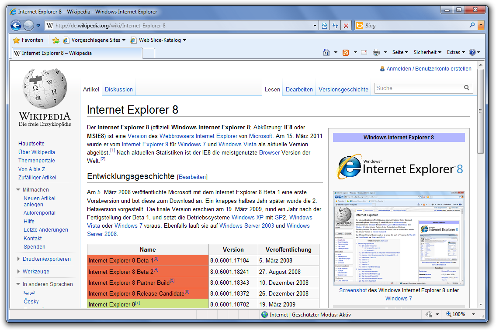
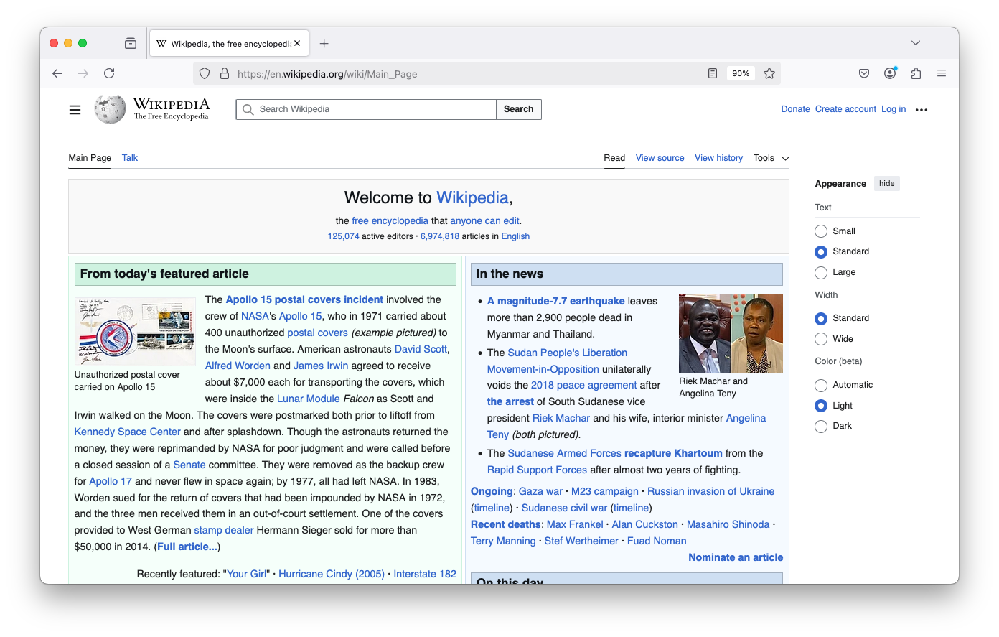
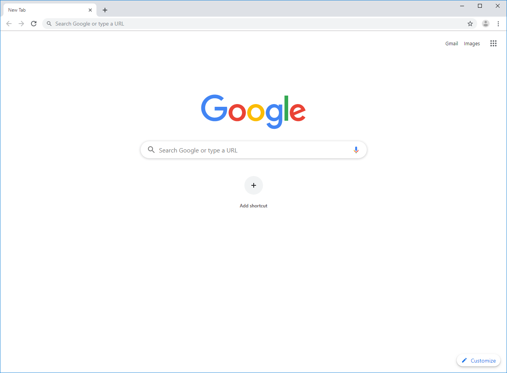
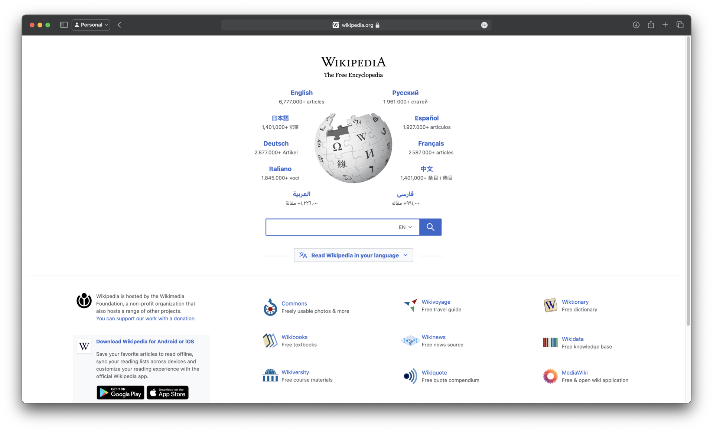
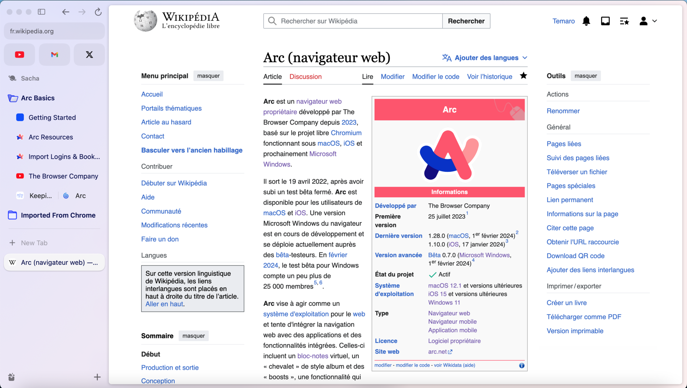
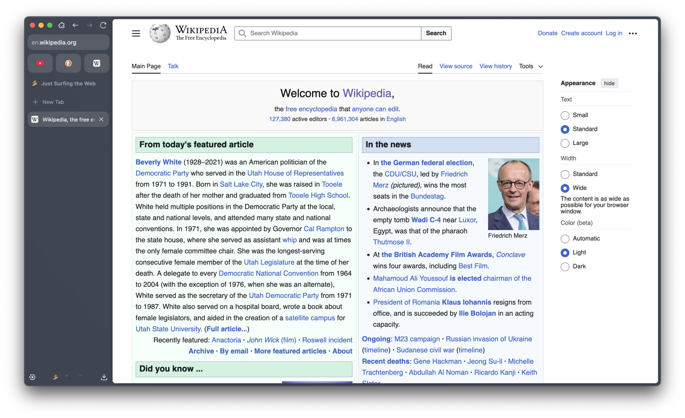

## My first steps on a PC

I've been around computers for as long as I can remember: since kindergarten, to be exact. My father had bought a PC for work, and I no longer remember which one. Back then there was no internet connection, just a mouse, a keyboard and two games: Minesweeper and Solitaire.

After that, Free, a French internet provider (yes, that's its name), started handing out CDs that gave a few hours of free internet access. You needed a 56k modem, a phone line and dial-up software to install before you could connect. The modem screeched, it tied up the phone line, and there wasn't much to do online. Once the free hours ran out, staying online cost a fortune.

Next came ADSL broadband subscriptions. Our first one was with Wanadoo (France Télécom's internet provider at the time), and a sort of green manta ray appeared in our living room. You launched a program, connected, and that was it! MSN Messenger and my friends became a new playground, and Site du Zéro (a French learn-to-code website, now [OpenClassrooms](https://openclassrooms.com/)) a goldmine for learning all kinds of things about web programming.

## Internet Explorer, then the Firefox revelation

It was around then that I realized Internet Explorer, our browser at the time, wasn't necessarily the best tool.

*Internet Explorer 8 on Windows 7. Screenshot: [Das Schäfchen](https://commons.wikimedia.org/wiki/File:Windows_Internet_Explorer_8.png), CC BY-SA 3.0 DE.*

Another browser seemed far more advanced and smoother, and it was easy to add extensions to it: [Firefox](https://www.mozilla.org/firefox/). For years, it was the browser I installed by default on every machine I set up.

*Firefox 136 on macOS. Screenshot: [Paowee](https://commons.wikimedia.org/wiki/File:Firefox_136_screenshot,_macOS_Sonoma.png), CC BY-SA 4.0.*

## Chrome, the big switch

Then one day, a small company called Google released its own browser: [Chrome](https://www.google.com/chrome/). That was September 2008, and I started using it very soon after it came out. It was a revolution: faster, lighter, with a simpler interface. I couldn't wait to switch.

*Chrome 75 on Windows (2019). Screenshot: [WikiPimpi](https://commons.wikimedia.org/wiki/File:Google_Chrome_75_screenshot.png), public domain.*

## Safari, Opera and a few detours

In the 2010s, I got my first MacBook Pro. On a Mac, [Safari](https://www.apple.com/safari/) is hard to ignore: it's perfectly integrated into the system, so I started using it.

*Safari 17 on macOS Sonoma. Screenshot: [ChipsPacketLover](https://commons.wikimedia.org/wiki/File:Safari_17_on_macOS_Sonoma.png), CC0.*

Over the years I also explored other options, such as [Opera](https://www.opera.com/) and, later on, [Brave](https://brave.com/), which launched in 2016. But each time, I never found a good enough reason to switch.

## The Chromium trap

Chrome is built on [Chromium](https://www.chromium.org/), the engine (and open source project) led by Google. That engine isn't exclusive to Chrome: Opera, Brave, Edge and many others use it too. As a result, much of the web runs on a single engine, whose direction is largely set by a single company.

Uneasy about the direction Google was taking Chromium in, I felt more and more trapped. So I went back to Firefox. Even if its interface felt a bit dated, it was more in line with my values. And in the meantime, its engine, Gecko, had closed much of the gap with Chromium.

## Arc: the interface that made me forget everything else

Then a startup called The Browser Company launched a browser of its own: [Arc](https://arc.net/). After a long invite-only beta, it opened to everyone in July 2023.

I had no illusions: I knew Arc ran on Chromium under the hood. But its take on the interface won me over:

- tabs on the side instead of the top;
- a clear split between temporary tabs and pinned ones, with easy-to-spot quick access;
- an unobtrusive address bar, thoughtful integrations, and more.

*Arc and its tab sidebar. Screenshot: [Temaro](https://commons.wikimedia.org/wiki/File:Screenshot_Arc_Browser.png), CC0.*

I'll admit I got hooked fast, and for a while I set my convictions aside.

## uBlock Origin, or how Chromium caught up with me

Between October 2024 and July 2025, Google gradually disabled extensions built on the old "Manifest V2" format in Chrome, as it rolled out the new one, "Manifest V3". Since Arc is built on Chromium, it ended up in the same situation. Among the casualties was an extension I'm particularly fond of: [uBlock Origin](https://ublockorigin.com/).

To see why, you need to know how it works. uBlock Origin is a content blocker: for every request the browser is about to send (an image, a script, an ad tracker), the extension checks the address against its long, constantly updated filter lists, and cancels the request if it's unwanted. That relies on an API that lets an extension inspect and intercept requests **in real time**: `webRequest`, in blocking mode.

Manifest V3 removes that blocking mode. In its place, Google offers `declarativeNetRequest`: the extension has to declare its rules in advance, and the browser applies them without the extension ever seeing the requests go by. The number of rules is capped, and the most fine-grained filters become impossible to write. Google justifies the change on grounds of security, privacy and performance: an extension that reads every request live is a risk. Its critics, including uBlock Origin's developer, mostly see a deliberate weakening of ad blockers by a company whose business model relies on advertising.

The developer does offer a lighter version, uBlock Origin Lite, compatible with Manifest V3. But it's less powerful, and I didn't want to settle for it. Firefox, for its part, chose to keep supporting the blocking mode of `webRequest`.

So it was back to Firefox, even if it meant a less pleasant user experience. It wasn't that big a deal, really.

## Firefox, again (but not fully satisfied)

I have to admit that Mozilla has put in a lot of work in recent years to move the browser forward, interface included. Still, it never gave me the same satisfaction as Arc.

## The end of Arc, and a discovery

Then came the bad news. Arc had been in maintenance mode since May 2025, after its maker decided to focus on another browser, Dia, and was then acquired by Atlassian. On October 22, 2026, The Browser Company announced Arc's end of life, scheduled for December 22, 2026. A very short life.

While looking into what Arc users were switching to, I came across a project I'd never heard of: an open source browser that uses **Gecko**, Firefox's engine. Its name: [Zen](https://zen-browser.app/).

## Zen: Arc's experience on Firefox's engine

The idea is dead simple: deliver Arc's user experience, but on Gecko. Brilliant. I jumped on it: I downloaded it, tried it, and within an hour it was my default browser.

*Zen Browser 1.8.2b on macOS. Screenshot: [KiwiTheGamer](https://commons.wikimedia.org/wiki/File:Zen_Browser_1.8.2b_on_MacOS.png), CC BY-SA 4.0.*

Of course it's still in beta, and its version numbers still carry a "b". But for the way I use it, I'm very happy with it as it stands. It has the side tabs, the workspaces, the quick access, and above all my extensions, uBlock Origin first among them. On top of that, it runs on an engine that doesn't depend on Google.

## The flip side: DRM

There is one catch, though, and I'd rather be upfront about it: Zen can't yet play DRM-protected content. That doesn't bother me, since I don't watch Netflix or listen to Spotify in my browser. But it may matter to you, so here is what's going on.

DRM (*Digital Rights Management*) is a set of protections meant to prevent copying of content, videos and music in particular. On the web it works like this: the service encrypts the stream, and the browser has to decrypt it using a closed-source software module, a *CDM* (*Content Decryption Module*), called through a standard API, the *Encrypted Media Extensions*. The most widespread CDM is **Widevine**, and it belongs to Google. Netflix, Disney+, Prime Video and others depend on it.

To ship Widevine, a browser has to obtain a license from Google. That's feasible for an established organization like Mozilla, whose Firefox can download it on demand, but much harder for a young community project. According to discussions on the project's repository, Zen is still waiting for that approval.

The practical consequence: on a service that requires Widevine, the video won't start or shows an error. You then have to switch to another browser. For me that's Firefox, which stays installed for those cases.

User reports vary with the system and version and sometimes contradict each other, so if this is crucial for you, test it on your own machine before committing.

## So, which browser should you choose?

There's no single right answer, and that's the point of this whole journey: over twenty years, my browser has changed along with my habits, my needs and my convictions, not because I found some absolute "best" browser.

Before choosing, it's worth asking yourself a few questions:

- **What do you do day to day?** If you stream TV shows, DRM matters. If you mostly work in web apps, smoothness and tab management matter more.
- **What do you expect from the interface?** Tabs on top or on the side, simplicity or customization: it's a matter of taste, and nothing is more personal.
- **How much do your extensions matter?** If an ad or tracker blocker is essential to you, check what each browser actually allows.
- **How do you feel about the web's reliance on a single engine?** Chromium powers a huge share of browsers, with Gecko and WebKit (Safari's engine) as the alternatives. Whether your choice is principled or pragmatic, it's best made with your eyes open.
- **Which ecosystem do you live in?** Safari on a Mac and an iPhone, Chrome with a Google account, Firefox with Firefox Sync: integration has real value.

My own journey is proof that a choice is never final. I've switched browsers several times, and the end of Arc reminded me that a tool can disappear overnight. So try, compare, and keep the one that suits you, knowing why you chose it.
