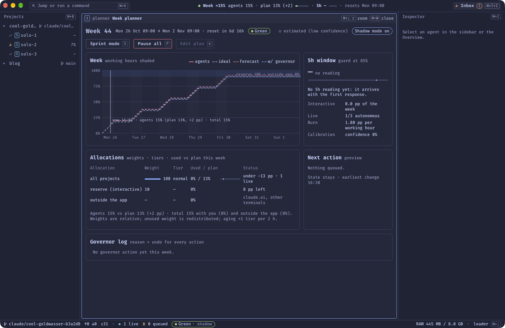
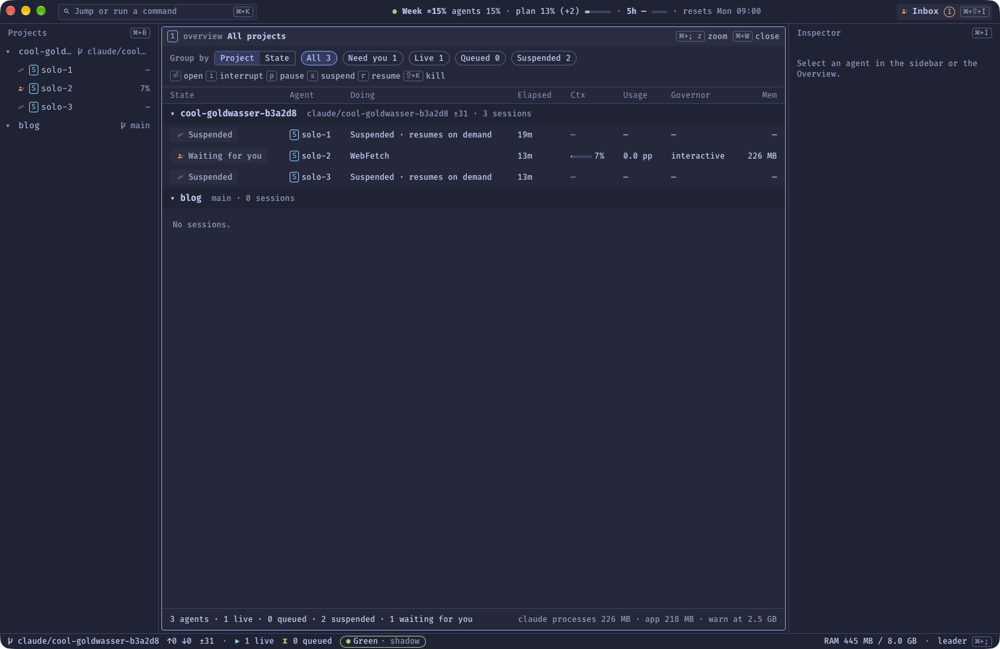

## From a simple chat to a dozen sessions

Since February 2025, Claude Code has been part of my daily routine as a developer. At first it was a simple chat where I asked for one specific feature on one very particular point, a narrow scope.

A few months later I took the plunge and moved to the CLI version of Claude Code, so I could keep my working habits. Neovim has been my daily editor since 2020, and I've always preferred terminal tools to heavy clients.

Until recently, then, I worked with Claude Code from a terminal. But this summer I got tired of spending my time jumping between tabs, projects and features, and above all of approving operations that didn't deserve my attention.

## What I tried first

I started by reviewing my methodology: spending more time on the upfront phases to write a specification for each feature, adding a design phase (specs and drawings), and so on. It helped, but it didn't get rid of the feeling of being overwhelmed by all the tabs and sessions.

Then, at the peak of my productivity, I hit two other limits:

- **my machine's resources**: only 8 GB of RAM and a maxed-out CPU;
- **my Anthropic subscription's limits**: a Max plan, which isn't infinite.

My first reflex, in September, was to go back to the Claude Code desktop app. Navigation hurt less right away, and I got lost between projects less often. But my productivity eventually dropped: I could only run two or three sessions at once.

## The requirements

In mid-October, I laid the foundations of a project meant to solve most of these problems:

- make the best use of my machine's resources;
- not burn through my Claude plan in two days, and keep an eye on the 5-hour usage window;
- get a better view of how my projects are progressing;
- easily use different types of agents for different types of tasks;
- stop answering (or answer as little as possible) questions that don't need my attention, so I can focus on what matters: strategic decisions.

So here is **[Orchestrator](https://github.com/GuillaumeOj/orchestrator)**. Sorry, the name isn't very original.

## Warning: a personal tool, with clear limits

Before going further, three things you should know.

> **Orchestrator is a personal project.** It's public, but I'm not offering it as a product, and there's no support.
>
> - **It only runs on macOS.**
> - **It's designed for a Claude Max subscription (or equivalent).** It relies on the official Claude Code CLI logged in with a Pro or Max account, and refuses to start agents with an API key.
> - **It must not be used unsupervised.** Anthropic's terms of use don't allow running Claude Code without human supervision. Orchestrator aims for the opposite: cutting *pointless* interruptions, not taking me out of the loop. The decisions that matter stay mine. If you want to take inspiration from it, re-read the terms currently in force.

To be upfront about it: this tool was built for my needs, on my machine, around my habits.

## What Orchestrator is

Orchestrator is a **local** macOS application (no server, everything stays on the machine) for running software projects with Claude Code agents. It's written in **Rust with Tauri 2**, with an interface in **Svelte 5**. It doesn't reinvent Claude Code: each agent is the **real `claude` CLI**, running in an embedded terminal.

In practice, it gives me four things.

### One worktree per agent

Each session starts in its own **git worktree**, an isolated working folder next to the repository. Two agents never step on each other's toes, and nothing reaches my main checkout until I've reviewed it.

You can start a solo session or a **team** of specialized agents: a lead, a backend, a frontend, a UI and a UX. That's how I get different agents for different tasks.

### My terminal and my editor, in the same window

Each agent has its own pane: the real Claude Code terminal, with a shell next to it and **my own Neovim**, complete with my full configuration. The terminal's look is even imported from my kitty config, so I keep my habits without juggling ten terminal tabs.

### A Governor to make the plan last

This is the piece I'm happiest with. The **Governor** is a Rust library with no I/O at all: a control law that spreads the agents' work across the week, so Claude's weekly limit lasts *until the reset* and the 5-hour window stays free for my interactive work.

It starts from a weekly plan: working days and hours, a reserve for my own sessions, and a weight per project. It measures consumption, estimates what each percentage point of the week costs, forecasts where things will end up, and decides whether to admit or queue each task. Every decision is logged with its reason and can be undone.

For now it runs in **shadow mode**: during this first week it only records what it *would* have done and blocks nothing. I'm checking that its forecasts match reality before letting it decide.

*The week planner: actual usage, ideal curve, forecast and Governor state.*

### Going easy on the machine

The app itself is light: about 250 MB with three agent panes open. The `claude` processes weigh about 220 MB each, so RAM remains my bottleneck. Orchestrator watches memory pressure and **suspends** surplus agents, then resumes them when a slot frees up. When I quit, the agents are suspended and their sessions are restored at the next launch.

*The overview: every agent, what it's doing, its memory and its usage.*

## Keeping control without approving every line

For agents to work without constantly pestering me, they have to be properly **locked down**. So part of the project is devoted to security:

- each agent runs inside Claude Code's **sandbox**: it can only write to its own worktree, and it can't read my SSH keys, my `gh` tokens or my other repositories;
- agents have **no credentials**: pushing code, opening a pull request or merging goes through the app, via controlled MCP tools, with my approval;
- Claude Code's permission requests land in a single **inbox**, instead of blocking some random tab.

## What doesn't work yet

After a first real team run, I took stock, and it was rather humbling. In that run: **29 permission prompts** across 5 agents, 6 times I had to type into the lead's terminal myself, and about 5 agent-hours lost waiting on something nobody could see from the outside. A good part came from bugs in the app itself, which I've fixed since.

The takeaway: I was still diving into panes to unblock agents. Hence the next step, designed but **not built yet**: a single **Overwatch** agent that would see every project, settle permissions according to a policy I write, answer questions already covered in the docs, and leave me only the real decisions (scope, product, security, anything irreversible). Agent panes would become an escape hatch, never a requirement.

## A word on design

The interface is **very austere**, partly by choice and partly because I didn't take the time to work on it. I wanted to focus on features and keep things sober: monospaced text, tables, keyboard shortcuts everywhere, and a dark palette. It won't win any beauty contests, but everything is readable and quick to use from the keyboard, which is enough for now.

(The screenshots above come from the first version, at the end of October. The home screen will change once the Overwatch lands.)

## Where the project stands

I use Orchestrator daily, but it's still evolving. Updates ship with every green commit on `main` as a signed app, and you can even try a pull request's build before it merges.

The code is here: [github.com/GuillaumeOj/orchestrator](https://github.com/GuillaumeOj/orchestrator). If the topic interests you, the [specification](https://github.com/GuillaumeOj/orchestrator/blob/main/docs/SPEC.md) and the [architecture decisions](https://github.com/GuillaumeOj/orchestrator/tree/main/docs/adr) are probably more instructive than the code itself.

I'll come back to the Overwatch once it exists, with numbers: how many permission prompts it absorbs and how often I still have to open a pane.
