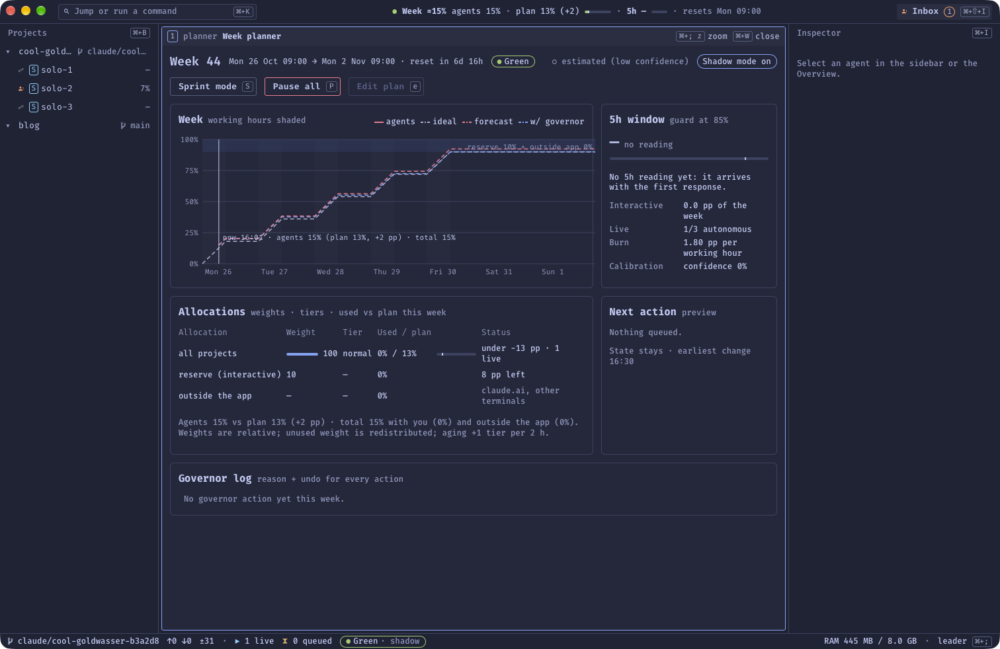
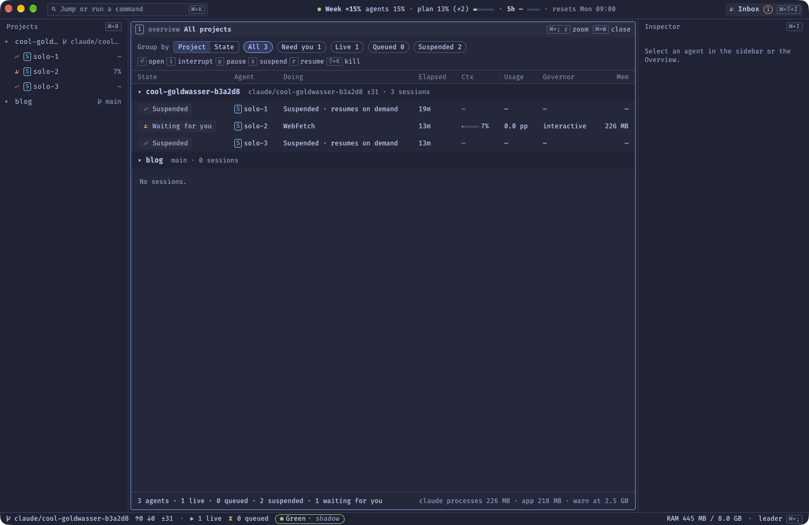

## D'un simple chat à une dizaine de sessions

Claude Code fait partie de mon quotidien de développeur depuis février 2025. Au début, c'était un simple chat auquel je demandais d'ajouter une fonctionnalité précise, sur un point précis, dans un périmètre très réduit.

Quelques mois plus tard, j'ai franchi le pas et je suis passé à la version CLI de Claude Code, pour conserver mes habitudes de travail. Neovim est mon éditeur quotidien depuis 2020, et j'ai toujours préféré les outils en terminal aux clients lourds.

Jusqu'à récemment, je travaillais donc avec Claude Code dans un terminal. Mais cet été, j'en ai eu assez de passer mon temps à naviguer entre les onglets, les projets et les fonctionnalités. Et surtout de valider des opérations qui ne méritaient pas mon attention.

## Ce que j'ai essayé avant

J'ai d'abord revu ma méthodologie : approfondir les phases préliminaires pour écrire les spécifications de chaque fonctionnalité, ajouter une phase de design (spécifications et dessin), etc. C'est utile, mais ça n'a pas fait disparaître le sentiment d'être submergé par la navigation entre onglets et sessions.

Puis, au pic de ma productivité, j'ai heurté deux autres limites :

- **les ressources de ma machine** : 8 Go de RAM seulement, et un processeur saturé ;
- **les ressources de mon abonnement Anthropic** : un abonnement Max, qui n'est pas infini.

Mon premier réflexe, en septembre, a été de repasser sur l'application desktop de Claude Code. J'ai tout de suite moins souffert de la navigation et je me perdais moins entre les projets. Mais ma productivité a fini par chuter : je ne pouvais plus lancer que deux ou trois sessions en même temps.

## Le cahier des charges

Mi-octobre, j'ai posé les bases d'un projet censé résoudre la plupart de ces problèmes :

- optimiser les ressources de ma machine ;
- ne pas brûler le forfait de mon compte Claude en deux jours, tout en gardant un œil sur la fenêtre d'usage de 5 heures ;
- avoir une meilleure vision de l'avancement de mes différents projets ;
- utiliser facilement différents types d'agents pour différents types de tâches ;
- ne plus avoir à répondre (ou le moins possible) à des questions qui ne demandent pas mon attention, pour me concentrer sur ce qui compte : les décisions stratégiques.

Voici donc **[Orchestrator](https://github.com/GuillaumeOj/orchestrator)**. Désolé, le nom n'est pas très original.

## Avertissement : un outil personnel, avec des limites claires

Avant d'aller plus loin, trois précisions importantes.

> **Orchestrator est un projet à usage personnel.** Il est public, mais je ne le propose ni comme un produit, ni avec du support.
>
> - **Il ne fonctionne que sur macOS.**
> - **Il est conçu pour un abonnement Claude Max (ou équivalent).** Il s'appuie sur le CLI officiel de Claude Code connecté à un compte Pro ou Max, et refuse de démarrer avec une clé d'API.
> - **Il ne doit pas être utilisé sans supervision.** Les conditions d'utilisation d'Anthropic n'autorisent pas un usage de Claude Code sans supervision humaine. Orchestrator vise l'inverse : réduire les interruptions *inutiles*, pas me retirer de la boucle. Les décisions qui comptent restent les miennes. Si vous voulez vous en inspirer, relisez les conditions en vigueur.

Je vous le dis franchement : c'est un outil construit pour mon besoin, sur ma machine, avec mes habitudes.

## Ce qu'est Orchestrator

Orchestrator est une application macOS **locale** (aucun serveur, tout reste sur la machine) qui fait avancer des projets logiciels grâce à des agents Claude Code. Elle est écrite en **Rust avec Tauri 2**, et son interface en **Svelte 5**. Elle ne réinvente pas Claude Code : chaque agent est le **vrai CLI `claude`**, lancé dans un terminal intégré.

Concrètement, elle apporte quatre choses.

### Un worktree par agent

Chaque session démarre dans son propre **worktree git**, un dossier de travail isolé à côté du dépôt. Deux agents ne se marchent donc pas dessus, et rien n'est écrit dans mon checkout principal tant que je n'ai pas relu.

On peut lancer une session solo ou une **équipe** d'agents spécialisés : un lead, un backend, un frontend, un UI, un UX. C'est la réponse à mon besoin d'agents différents pour des tâches différentes.

### Mon terminal et mon éditeur, dans la même fenêtre

Chaque agent a son panneau : le vrai terminal Claude Code, avec à côté un shell et **mon propre Neovim**, avec toute ma configuration. L'apparence du terminal est même importée depuis ma config kitty. Je garde mes habitudes, sans jongler entre dix onglets de terminal.

### Un Governor pour faire durer le forfait

C'est la pièce dont je suis le plus content. Le **Governor** est une bibliothèque Rust pure, sans aucune I/O : une loi de commande qui répartit le travail des agents sur la semaine, pour que la limite hebdomadaire de Claude dure *jusqu'à la réinitialisation*, tout en gardant la fenêtre de 5 heures libre pour mon travail interactif.

Il part d'un plan hebdomadaire : jours et heures travaillés, une réserve pour mes propres sessions, et un poids par projet. Il mesure la consommation, estime ce que coûte chaque point de pourcentage de la semaine, prévoit où l'on va arriver, et décide de lancer ou de mettre en file d'attente chaque tâche. Chaque décision est journalisée avec sa raison, et on peut l'annuler.

Pour l'instant, il tourne en **shadow mode** : pendant la première semaine, il note ce qu'il *aurait* fait sans rien bloquer. Je vérifie que ses prévisions collent à la réalité avant de le laisser décider.

*Le planificateur de semaine : consommation réelle, courbe idéale, prévision et état du Governor.*

### Ménager la machine

L'application elle-même est légère : environ 250 Mo avec trois panneaux d'agents ouverts. Les processus `claude` pèsent chacun environ 220 Mo, donc la RAM reste ma contrainte. Orchestrator surveille la pression mémoire et **suspend** les agents en trop, puis les reprend quand une place se libère. À la fermeture, les agents sont suspendus et leur session est reprise au lancement suivant.

*La vue d'ensemble : chaque agent, ce qu'il fait, sa mémoire et sa consommation.*

## Garder la main sans valider chaque ligne

Pour que les agents travaillent sans me solliciter à tout bout de champ, il faut qu'ils soient bien **cloisonnés**. Une partie du projet est donc consacrée à la sécurité :

- chaque agent tourne dans la **sandbox** de Claude Code : il ne peut écrire que dans son worktree, et ne peut pas lire mes clés SSH, mes jetons `gh` ou les autres dépôts ;
- les agents n'ont **aucun credential**. Pousser du code, ouvrir une pull request ou fusionner passe par l'application, via des outils MCP contrôlés, avec une validation de ma part ;
- les demandes de permission de Claude Code arrivent dans une **inbox** unique, au lieu de bloquer un onglet quelconque.

## Ce qui ne marche pas encore

Après une première vraie session d'équipe, j'ai fait le bilan, et il est plutôt modeste. Sur ce test : **29 demandes de permission** réparties sur 5 agents, 6 fois où j'ai dû taper moi-même dans le terminal du lead, et environ 5 heures d'agent perdues à attendre quelque chose que personne ne voyait de l'extérieur. Une bonne partie venait de défauts de l'application elle-même, que j'ai corrigés depuis.

Le constat de fond : je continuais à plonger dans les panneaux pour débloquer les agents. D'où la prochaine étape, déjà dessinée mais **pas encore construite** : un agent **Overwatch** unique, qui verrait tous les projets, trancherait les permissions selon une politique que je définis, répondrait aux questions dont la réponse figure déjà dans les docs, et me laisserait uniquement les vraies décisions (périmètre, produit, sécurité, tout ce qui est irréversible). Les panneaux d'agents deviendraient une porte de secours, jamais une obligation.

## Un mot sur le design

L'interface est **très austère**, en partie par choix et en partie parce que je n'ai pas pris le temps de m'y consacrer. Je voulais me concentrer sur les fonctionnalités et garder quelque chose de sobre : de la police monospace partout, des tableaux, des raccourcis clavier partout, et une palette sombre. Ça ne gagnera aucun concours de beauté, mais tout est lisible et rapide au clavier, ce qui me suffit pour le moment.

(Les captures ci-dessus datent de la première version, fin octobre. L'écran d'accueil va changer avec l'Overwatch.)

## Où en est le projet

Orchestrator est utilisé au quotidien, mais reste un projet en évolution. Les mises à jour arrivent à chaque commit vert sur `main`, sous la forme d'une application signée, et on peut même essayer le build d'une pull request avant sa fusion.

Le code est ici : [github.com/GuillaumeOj/orchestrator](https://github.com/GuillaumeOj/orchestrator). Si le sujet vous intéresse, la [spécification](https://github.com/GuillaumeOj/orchestrator/blob/main/docs/SPEC.md) et les [décisions d'architecture](https://github.com/GuillaumeOj/orchestrator/tree/main/docs/adr) sont probablement plus instructives que l'application elle-même.

Je reviendrai sur l'Overwatch quand il existera, et avec des chiffres : combien de demandes de permission il absorbe, et combien de fois je dois encore ouvrir un panneau.
